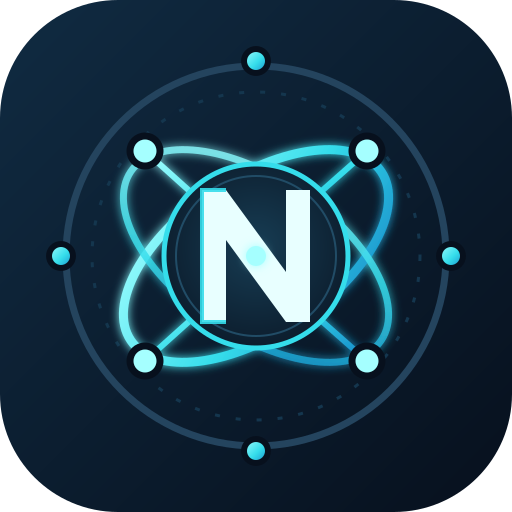

# Neural HUD 2.0

Neural HUD é um HUD flutuante Android com um interpretador local de instruções. Não usa API de IA: os comandos, sinônimos, regras de acionamento e ações compatíveis já estão implementados no código; as instruções do usuário são guardadas localmente.

## Como funciona

1. Abra o app. Se a permissão de sobreposição ainda não estiver ativa, o Android abre diretamente a página de permissão.
2. Ao voltar depois de permitir, a esfera e o painel de comandos são iniciados automaticamente.
3. No campo fixado na parte inferior do painel, escreva o que fazer e toque em **Salvar e ativar instrução**.
4. Para o HUD executar ações em outros apps, abra **Ativar IA nos aplicativos (Acessibilidade)** e habilite o serviço nas configurações do Android. O Android exige que essa permissão seja concedida manualmente.
5. Abra o app-alvo. O interpretador verifica o pacote ativo e tenta executar apenas as ações que reconhece.

## Exemplos de instrução

- `Quando abrir YouTube, pesquise gatos`
- `Quando abrir Chrome, toque em Pesquisar e depois digite tutorial de Python`
- `Quando abrir Chrome, digite https://example.com`
- `Quando abrir YouTube, role para baixo`
- `Quando abrir Chrome, volte`
- `Pesquise clima no Rio de Janeiro` — sem app-alvo, a instrução roda uma vez no próximo app aberto.

Ações locais previstas no código: pesquisar, digitar em campo editável, tocar em texto/controle acessível, voltar, ir à tela inicial, rolar, aguardar e abrir um app instalado. Se não localizar uma caixa de pesquisa acessível, a ação de pesquisa abre a busca Google no navegador.

## Limites e privacidade

- Não é um LLM nem possui inteligência geral. É um motor determinístico de linguagem natural limitada, com regras e sinônimos pré-programados.
- Ações dependem da estrutura de acessibilidade do app-alvo; apps que desenham uma interface própria podem não expor botões/campos e algumas ações podem falhar.
- O serviço de Acessibilidade não pode ser habilitado silenciosamente pelo app: o usuário precisa ativá-lo nas configurações do Android.
- Campos identificados como senha são ignorados. O texto digitado no campo de comando e as regras ficam no armazenamento privado do app; não são enviados a uma API.
- A busca web abre o navegador normal e usa a conexão do dispositivo.
- O HUD pode ser arrastado, minimizado, pausado e encerrado; tamanho e opacidade são configuráveis.

## Compilar

O workflow `.github/workflows/build-apk.yml` compila em runner Linux do GitHub Actions. Abra **Actions → Build Neural HUD APK** e baixe o artefato `neural-hud-debug-apk`. O build usa JDK 17, Gradle 8.9 e Android SDK 35.
